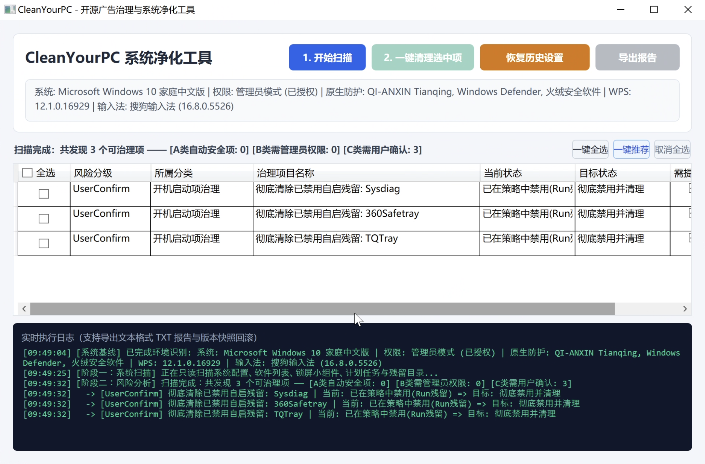

<div align="center">

# CleanYourPC 🧹

**Restore system purity — An open-source ad mitigation and system purification tool for everyone.**

[](https://opensource.org/licenses/MIT)
[](https://github.com/zhihuzeye/CleanYourPC/actions/workflows/ci.yml)
[](https://dotnet.microsoft.com/)
[](#2-supported-operating-systems)
[](CONTRIBUTING_en.md)

<p align="center">
  <a href="README.md">简体中文</a> | <b>English</b>
</p>

[Features](#1-what-problems-does-it-solve) • [Download](#3-quick-download--installation) • [Build from Source](#4-build--compilation) • [FAQ](#6-frequently-asked-questions-faq) • [Contributing](#7-contributing)

</div>

---

> [!IMPORTANT]
> **Disclaimer**  
> 1. CleanYourPC is an open-source public-welfare software. All code and JSON rule sets are 100% transparent and open.  
> 2. CleanYourPC automatically archives versioned system snapshots before applying any registry, service, or system modifications. However, operating system environments vary. **Before performing critical cleanup operations (especially forced software uninstallation), please ensure open documents are saved and you understand the selected items.**  
> 3. The authors and contributors shall not be held liable for any unexpected system issues or data loss arising from the use of this software.

---

## 📸 Interface Preview

<div align="center">
  
  <p><em>Clean, intuitive, one-click scan and mitigation without complicated traps</em></p>
</div>

---

## 1. What Problems Does It Solve?

In daily PC usage, intrusive lock-screen widgets, native system promotional tips, bundled adware, and watchdog background popups cause constant frustration. CleanYourPC provides safe, transparent, and reversible solutions:

1. **Lock Screen & Native Windows Promotions Mitigation**:
   - One-click disabling of dynamic lock-screen widgets (e.g. Weather and more, sports scores, today in history).
   - Turns off Windows Spotlight promotional tips, Start Menu app suggestions, Taskbar "News and Interests" popups, Action Center marketing tips, and File Explorer sync banners.
2. **WPS Office Ad & Silent Downloader Neutralization**:
   - Disables unnecessary background cloud wakeup services (`wpscloudsvr`).
   - Applies read-only immunity locks to `download` and `update` cache directories, permanently stopping silent background downloads of promotional software, while **100% preserving core document, spreadsheet, slide, and PDF editing features**.
3. **Input Method Ad & Popup Neutralization**:
   - Deeply inspects Sogou, Baidu, iFlytek, and QQ Pinyin input methods.
   - Blocks hot-news popups, skin marketing promotions, and persistent ad daemons **without disrupting normal typing and candidate selection**.
4. **Adware Residue & Unwanted Scheduled Tasks Cleanup**:
   - Automatically detects residual scheduled tasks left behind after 360 uninstallations (e.g. `QihooGetWordSearchFatch`), bundled archive watchdogs (`beijing-zipgo`, `ProZip`), and hook DLL paths.
5. **Force Direct Uninstallation (360 / 2345 / Bundled Adware)**:
   - Supports a direct forced removal mode similar to Geek Uninstaller.
   - Upon explicit user confirmation, terminates resident daemon processes, shreds physical directories, deregisters Windows Uninstall keys, and purges startup items **without calling tedious retention dialogs or uninstaller wizards**.
   - Built-in system safelist strictly protects native Windows security (Windows Defender) and essential hardware drivers.
6. **Anti-Silent-Installation Hardening**:
   - Supports configuring UAC credential prompt policies (`ConsentPromptBehaviorAdmin=1`) to prevent stealth elevation by background installers.
7. **Versioned Snapshot Management (One-Click Reversible Rollback)**:
   - Automatically archives structured snapshots (`v1.0`, `v1.1`...) before cleanup, allowing precise one-click rollback at any time.
8. **Structured Text Report Export**:
   - Exports scan and mitigation findings into clean, readable `.txt` diagnostic reports.

---

## 2. Supported Operating Systems

- **Windows Series**:
  - Windows 11 (64-bit, all editions)
  - Windows 10 (64-bit, 1809 and above)
- **Chinese Desktop Operating Systems**:
  - UnionTech Desktop OS (UOS)
  - Kylin Linux Desktop OS
  - Deepin Desktop OS
  - HarmonyOS PC / openEuler

---

## 3. Quick Download & Installation

### Option A: Portable Standalone Release (Recommended for end-users)

1. Navigate to the GitHub **[Releases Page](https://github.com/zhihuzeye/CleanYourPC/releases)** and download the latest `CleanYourPC-win-x64.zip`.
2. Extract to any directory. Right-click `CleanYourPC.App.exe` and select **Run as administrator**.
3. Click "Scan" to detect existing promotional items, review checkboxes, and click "Clean".

---

## 4. Build & Compilation

### Prerequisites
- [.NET 8.0 SDK](https://dotnet.microsoft.com/download/dotnet/8.0) or [.NET 9.0 SDK](https://dotnet.microsoft.com/download/dotnet/9.0)

### Build Commands
```powershell
# 1. Run automated unit tests
dotnet test

# 2. Launch desktop client (Windows environment)
dotnet run --project src/CleanYourPC.App/CleanYourPC.App.csproj

# 3. Publish Windows x64 self-contained single-file executable
dotnet publish src/CleanYourPC.App/CleanYourPC.App.csproj -c Release -r win-x64 --self-contained true -p:PublishSingleFile=true -o ./publish
```

### Cross-Architecture Compilation for Linux / Domestic OS (ARM64 / LoongArch64 / x64)
```bash
# Cross-compile for ARM64 (Phytium / Kunpeng / Kirin)
dotnet publish src/CleanYourPC.App/CleanYourPC.App.csproj -c Release -r linux-arm64 --self-contained true -p:PublishSingleFile=true -o ./publish-linux-arm64

# Cross-compile for LoongArch64 (Loongson)
dotnet publish src/CleanYourPC.App/CleanYourPC.App.csproj -c Release -r linux-loongarch64 --self-contained true -p:PublishSingleFile=true -o ./publish-linux-loongarch64
```

---

## 5. Architectural Overview

CleanYourPC decouples the core cleanup engine from the rules and user interface:

```
CleanYourPC/
├── .github/              # GitHub Actions CI/CD workflows & issue/PR templates
├── rules/                # Cross-platform JSON mitigation rules
│   ├── default-rules.json # Baseline default rules
│   └── ...               # OS-specific rules
├── src/
│   ├── CleanYourPC.Core/ # Core engine (Scanner, Snapshot, Registry/Service/Task providers)
│   └── CleanYourPC.App/  # WPF UI & Elevated Worker CLI
├── tests/
│   └── CleanYourPC.Tests/# Automated test suite (Sandbox, White-listing, Schema verification)
├── docs/                 # Design documentation and screenshots
└── CleanYourPC.sln       # Solution file
```

---

## 6. Frequently Asked Questions (FAQ)

### Q1: Will anti-virus software flag CleanYourPC as false positive?
**A**: Because CleanYourPC performs low-level actions such as terminating resident processes, modifying system policy registries, and removing registry keys without an expensive commercial EV code-signing certificate, some antivirus software might trigger heuristics. CleanYourPC is **100% open-source and transparent**, free of telemetry, backdoors, or malicious logic. You are welcome to inspect and compile the source code yourself.

### Q2: Why is "Run as administrator" recommended?
**A**: Disabling lock-screen widgets, preventing background services from starting, and wiping machine-level residual keys require writing to `HKLM` (Machine Registry) and managing system services. Standard user permissions can only alter `HKCU` (Current User), which cannot neutralize persistent machine-wide daemons.

### Q3: What should I do if I want to revert a cleanup action?
**A**: CleanYourPC automatically archives a timestamped, versioned snapshot prior to every cleanup execution. Open the "History & Snapshot Management" tab, select the corresponding snapshot, and click "One-Click Rollback" to restore previous settings.

### Q4: Could it inadvertently remove essential hardware drivers or system files?
**A**: Never. CleanYourPC enforces strict safety whitelisting. Core mitigation rules are verified by 19+ automated unit tests (`CleanYourPC.Tests`), strictly prohibiting modifications to audio, display, chipset, or core Windows components.

---

## 7. Contributing

Community contributions are warmly welcomed!
- Discover a new annoying popup? Submit a [Rule Request Issue](https://github.com/zhihuzeye/CleanYourPC/issues/new?template=rule_request.md).
- Please read our [Contributing Guide (English)](CONTRIBUTING_en.md) / [中文贡献指南](CONTRIBUTING.md).
- Follow our [Code of Conduct (English)](CODE_OF_CONDUCT_en.md).

---

## 8. License

Distributed under the [MIT License](LICENSE). You are free to use, modify, distribute, and integrate this software with proper copyright notice.

---

<div align="center">
  If CleanYourPC helped make your computer clean and quiet, please give us a ⭐️ <strong>Star</strong>!
</div>
